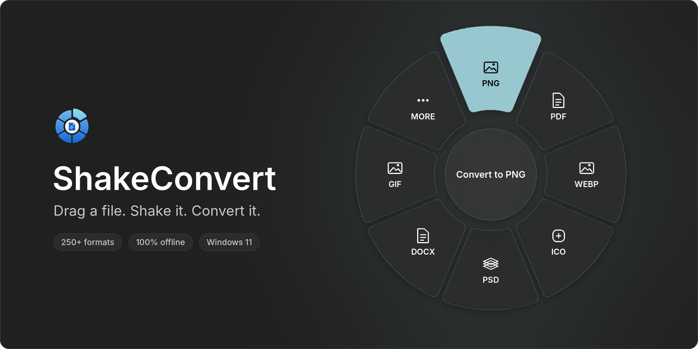
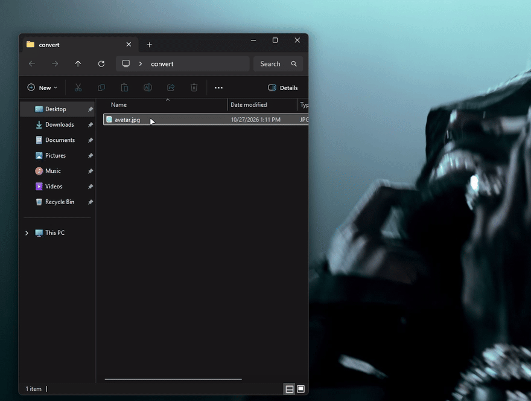
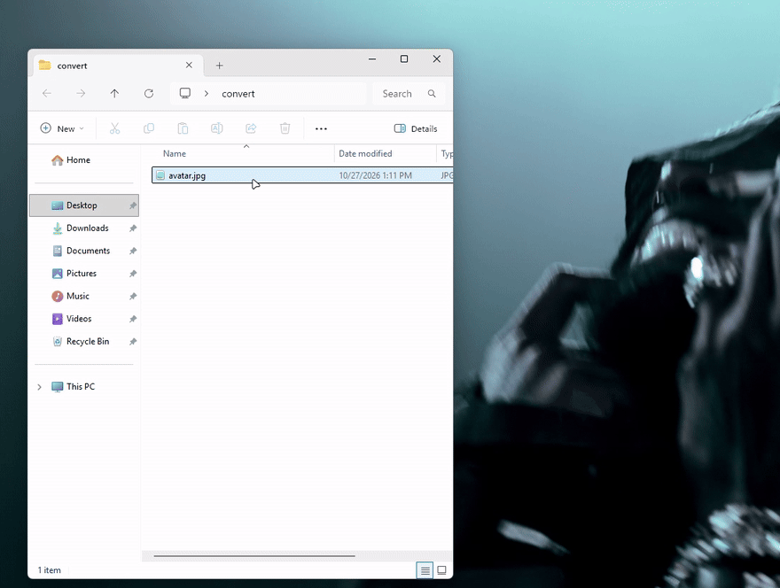
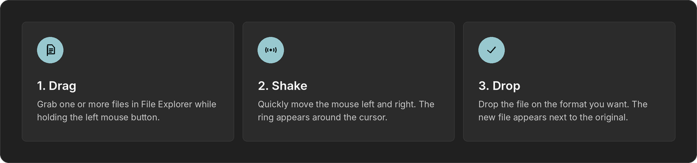
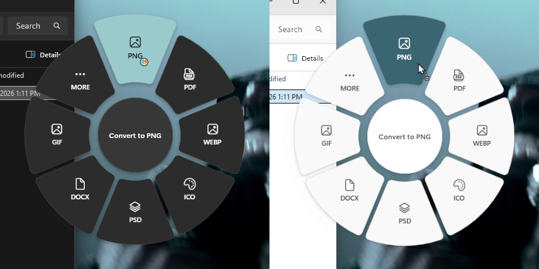
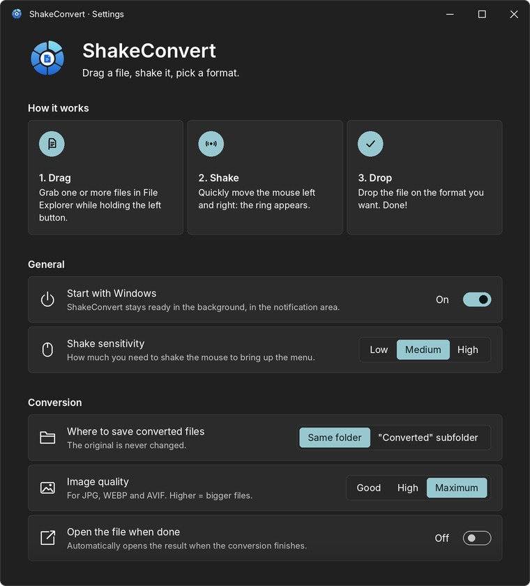
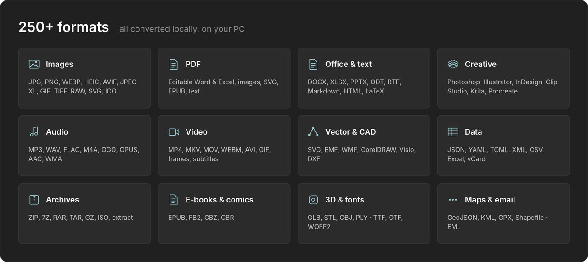

<p align="center">
  
</p>

<p align="center">
  <a href="../../releases/latest"></a>
  
  
  
</p>

<p align="center">
  <b>Drag a file. Shake the mouse. Drop it on a format.</b><br>
  A tiny, native-feeling Windows 11 converter for 250+ formats — and nothing ever leaves your PC.
</p>

<p align="center">
  
  
</p>

<p align="center"><sub>Real recordings on Windows 11, in dark and light theme. ShakeConvert is in English and automatically follows your Windows display language.</sub></p>

---

## ✦ How it works

<p align="center">
  
</p>

1. In File Explorer, grab one or more files with the left mouse button.
2. **Shake** the mouse left and right. A ring of formats opens around the cursor.
3. Drop the file on the slice you want. Drop it in the center, or outside the ring, to cancel.

The converted file shows up right next to the original, which is never touched. A small notification shows progress, lets you cancel, and opens the result.

When a file has more formats than fit in the ring, the last slice is **More**: hover over it for a moment (it fills with your accent color) and the ring flips to the next page.

## ✦ Made for Windows 11

<p align="center">
  
</p>

- **Real acrylic glass.** The ring uses the same material recipe as Start and the system flyouts, and follows your theme, accent color and *Transparency effects* setting.
- **Mica settings.** A clean settings window in the style of the Windows Settings app.
- **Light on resources.** The mouse hook runs on its own thread, so the cursor never lags. The app sleeps in the notification area until you shake.
- **Speaks your language.** English by default. The app automatically follows your Windows display language (English and Italian today).
- **No admin rights.** Installs per user.

<p align="center">
  
</p>

## ✦ Formats

<p align="center">
  
</p>

<details>
<summary><b>Full list</b></summary>

| From | To |
|---|---|
| **Images**: JPG, PNG, WEBP, AVIF, HEIC, GIF, TIFF, BMP, ICO, SVG, JPEG XL, TGA, RAW (CR2, CR3, NEF, ARW, DNG…) | JPG, PNG, WEBP, HEIC, AVIF, JPEG XL, JPEG 2000, PDF, ICO, GIF, TIFF, BMP, PSD, TGA, QOI, SVG (traced) · recognized text (OCR) → DOCX, TXT |
| **Photoshop**: PSD, PSB | Every image format, PDF |
| **Illustrator**: AI (PDF-compatible) | PDF, PNG, JPG, WEBP |
| **InDesign**: INDD, IDML | PDF, JPG, PNG of every page (needs InDesign) · IDML → Word, TXT |
| **Clip Studio Paint**: CLIP | PNG, JPG, PDF, WEBP, PSD, TIFF at full resolution |
| Krita, OpenRaster, Procreate, Affinity, Adobe XD, Sketch, CorelDRAW | PNG, JPG, PDF, WEBP, PSD, TIFF |
| **PDF** | Editable Word, Excel, PowerPoint\*, JPG, PNG, TIFF, WEBP, SVG, EPUB, CBZ, TXT, HTML, Markdown |
| **Word**: DOC, DOCX, ODT, RTF | PDF, DOCX, ODT, RTF, TXT, HTML, Markdown, Excel (tables), page images\* |
| **Excel**: XLS, XLSX, ODS, CSV | PDF\*, XLSX, ODS\*, CSV, JSON, HTML, Word |
| **PowerPoint**: PPT, PPTX, ODP | PDF\*, PPTX\*, ODP\*, slide images\* |
| **Text & markup**: Markdown, HTML, reST, LaTeX, Org, Typst, MediaWiki, DocBook, Jupyter | Word, PDF, HTML, EPUB, ODT, PowerPoint, and each other (pandoc) |
| **Audio**: MP3, WAV, FLAC, M4A, AAC, OGG, OPUS, WMA, AIFF, AC3, DTS, APE, WavPack, DSD… | MP3, WAV, FLAC, M4A, OGG, OPUS, AAC, WMA, WavPack, TTA, W64, AC3, E-AC3 |
| **Video**: MP4, MKV, MOV, AVI, WEBM, WMV, FLV, MPEG, TS, 3GP, VOB, MXF… | MP4, MKV, WEBM, MOV, AVI, GIF, APNG, MP3, WAV, M4A, still frame, SRT/ASS/VTT subtitles |
| **Vector & CAD**: SVG, EMF, WMF, CorelDRAW, Visio, CGM, ODG, DXF | PDF, SVG, PNG |
| **Data**: JSON, JSON Lines, YAML, TOML, XML, CSV, TSV, Excel, vCard | Each other, formatted Excel |
| **E-books & comics**: EPUB, FB2, CBZ, CBR, CB7 | PDF, Word, TXT, HTML, Markdown |
| **Subtitles**: SRT, ASS, SSA, VTT, SAMI, LRC, TTML, MicroDVD, SCC | SRT, ASS, VTT, TTML, LRC |
| **Archives**: ZIP, 7Z, RAR, TAR, GZ, BZ2, XZ, ISO, CAB, DEB, RPM, JAR… | Extract, ZIP, 7Z, TAR, TAR.GZ · any file → ZIP |
| **3D**: GLB, glTF, STL, OBJ, 3MF, PLY | Each other |
| **Fonts**: TTF, OTF, WOFF, WOFF2 | Each other |
| **Maps**: GeoJSON, KML, KMZ, GPX, Shapefile, CSV with coordinates | Each other, Excel |
| **Email**: EML, MHTML | PDF, HTML, TXT, Word |

\* Needs Microsoft Office or the free LibreOffice, which you can install from Settings.

Don't need them all? **Settings → Formats in the ring** lets you switch any target off.
</details>

## ✦ Install

1. Download `ShakeConvert-Setup-x.y.z.exe` from [**Releases**](../../releases/latest).
2. Run it. Everything is bundled: the .NET runtime, FFmpeg, 7-Zip and the local Python engines.
3. Drag a file and shake.

> [!NOTE]
> The installer isn't code-signed, so Windows SmartScreen may say *"Windows protected your PC"*. Click **More info → Run anyway**.

Requires 64-bit Windows 10 (1809 or later) or Windows 11.

## ✦ Build from source

Requires the [.NET 8 SDK](https://dotnet.microsoft.com/download/dotnet/8.0) on 64-bit Windows 10/11.

```bash
git clone https://github.com/oliseadario/ShakeConvert.git
cd ShakeConvert
dotnet run -c Release
```

Images, PDF, Office and text conversions work out of the box. Some formats use optional local tools, placed next to the built app (`bin\Release\net8.0-windows10.0.19041.0\win-x64\`):

| Tool | Where | Enables |
|---|---|---|
| [FFmpeg](https://ffmpeg.org/download.html) | `ffmpeg.exe` (or on your `PATH`) | Audio and video |
| [7-Zip](https://www.7-zip.org/) | `7zip\7z.exe` + `7z.dll` | Archives |
| [Python 3.12](https://www.python.org/downloads/windows/) | `engine\python\python.exe` | Editable PDF → Word/Excel, Clip Studio, data, fonts, 3D, maps, HEIC output |

Install the Python packages into that Python:

```bash
engine\python\python.exe -m pip install pdf2docx psd-tools pypandoc_binary pyyaml tomli-w xmltodict brotli trimesh ezdxf pyshp vtracer pillow-heif
```

## ✦ Privacy

ShakeConvert never connects to the internet while you use it. No telemetry, no accounts, no uploads. The only optional connection is installing LibreOffice through winget, and only if you ask for it. The full details are in [PRIVACY.md](PRIVACY.md).

## ✦ Project layout

| Path | What's inside |
|---|---|
| `App.cs`, `L.cs` | Startup, single instance, conversion flow, localization |
| `ShakeDetector.cs` | Low-level mouse hook on a dedicated thread, shake detection |
| `RadialWindow.cs`, `Acrylic.cs` | The ring: geometry, animation, drag & drop, acrylic material |
| `SettingsWindow.cs`, `ToastWindow.cs`, `Fluent.cs`, `Tray.cs`, `Theme.cs` | WinUI-style interface |
| `Converters.cs`, `MoreFormats.cs` | Format catalog and converters |
| `Engines.cs` | FFmpeg, Microsoft Office (COM), LibreOffice |
| `PdfSmart.cs`, `LocalEngine.cs`, `OfficeWriters.cs` | PDF → Word/Excel rebuilding, OCR, DOCX/XLSX writers |
| `EmbeddedPreview.cs`, `InDesignEngine.cs` | Creative formats |
| `engine/` | Local Python engines (pdf2docx, Clip Studio, data/fonts/3D/maps…) |

## ✦ License

Source code is [MIT](LICENSE). Bundled components keep their own licenses; see [THIRD-PARTY-NOTICES.md](THIRD-PARTY-NOTICES.md).

<p align="center"><sub>Made with stardust for Windows 11 ✦</sub></p>
